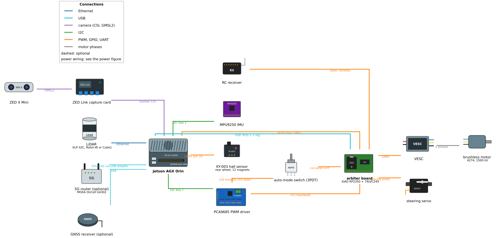
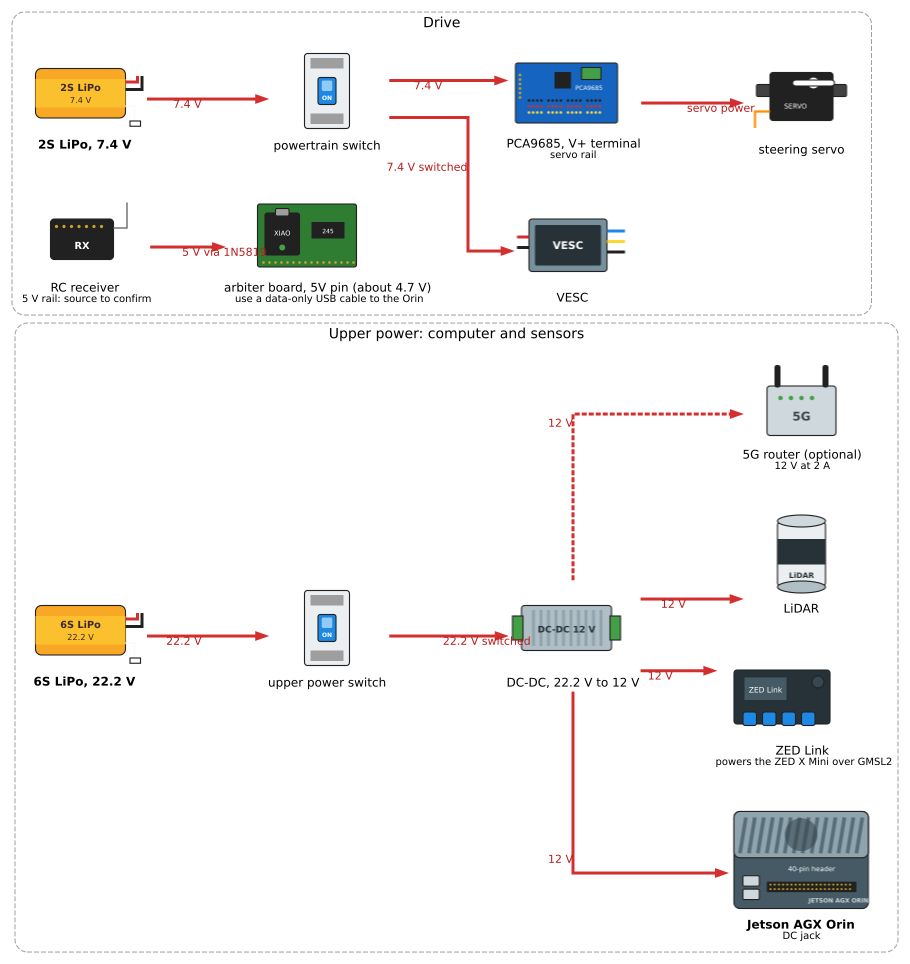

# Hardware Details

Physical hardware components and electrical specifications for the vehicle control system.

## PCA9685 PWM Driver

**Specifications**:
- **Model**: PCA9685 16-channel PWM controller
- **Interface**: I2C
- **I2C Address**: 0x40 (default)
- **I2C Bus**: Bus 7 (`/dev/i2c-7` on the AGX Orin, header pins 3 and 5)
- **PWM Frequency**: 60 Hz (`pwm_freq` in `actuator.yaml`)
- **Resolution**: 12-bit (4096 steps)

**Channel Assignments**:
- **Channel 0**: Motor ESC control
- **Channel 1**: Steering servo control
- **Channels 2-15**: Available for expansion

**I2C Wiring**:
```
PCA9685         Jetson/Computer
────────        ───────────────
VCC      ────── 3.3V or 5V (check board)
GND      ────── GND
SDA      ────── I2C SDA (pin 3, I2C bus 7)
SCL      ────── I2C SCL (pin 5, I2C bus 7)
```

**Power**:
- Logic power: 3.3V or 5V (from computer)
- Servo power: External 5V supply (V+, GND)
  - **Important**: Connect external 5V to V+ terminal for servos
  - Do NOT power servos from computer's 5V rail (insufficient current)

**Device Detection**:
```bash
# Check I2C devices on bus 7
sudo i2cdetect -y 7

# Expected output:
#      0  1  2  3  4  5  6  7  8  9  a  b  c  d  e  f
# 00:          -- -- -- -- -- -- -- -- -- -- -- -- --
# 40: 40 -- -- -- -- -- -- -- -- -- -- -- -- -- -- --
```

**Permissions**:

Add user to i2c group:
```bash
sudo usermod -a -G i2c $USER
# Log out and back in for changes to take effect

# Verify membership
groups $USER | grep i2c
```

**Python Library**:

The actuator node uses Adafruit's PCA9685 library:

```python
from Adafruit_PCA9685 import PCA9685

# Initialize PCA9685
pwm = PCA9685(address=0x40, busnum=7)  # i2c_busnum in actuator.yaml
pwm.set_pwm_freq(60)  # 60 Hz for RC servos/ESC

# Set motor PWM (channel 0)
pwm.set_pwm(0, 0, motor_pwm)

# Set steering PWM (channel 1)
pwm.set_pwm(1, 0, steering_pwm)
```

## Motor ESC

**Hardware**: Dynamite Fuze brushless ESC driving a 4274 / 1500 kV brushless motor

**PWM Signal Requirements**:
- Frequency: 60 Hz (16.7 ms period)
- A PWM value is a count out of 4096 per period, so the pulse width is
  `value × 16.67 ms / 4096` — about 4.07 μs per count. Neutral, 370, is a
  1.51 ms pulse.

**PWM values** (from `actuator.yaml`, which is the authority — read it there when it matters):

| Parameter   | Value | Meaning                                       |
|-------------|-------|-----------------------------------------------|
| `min_pwm`   | 360   | Lowest value the controller commands (reverse) |
| `brake_pwm` | 340   | Brake, used for forward-to-reverse transitions |
| `init_pwm`  | 370   | Neutral — the vehicle is stopped              |
| `max_pwm`   | 470   | Highest value the controller commands (forward) |

There is no fixed PWM-to-speed table. Speed is closed-loop: a PID controller
in the actuator node adjusts the PWM against the hall-sensor velocity, so the
PWM needed for a given speed changes with battery charge, load and floor. See
[Tuning & Testing](./tuning-and-testing.md) for calibration.

**Wiring**:
```
ESC             PCA9685          Motor           Power
────            ───────          ─────           ─────
Signal   ────── Channel 0
GND      ────── GND
                                 Phase A  ────── ESC A
                                 Phase B  ────── ESC B
                                 Phase C  ────── ESC C
Battery+ ──────────────────────────────────────── Battery+
Battery- ──────────────────────────────────────── Battery-/GND
```

**Power Requirements**:
- Operating voltage: 7.4 V (2S LiPo) on this vehicle; check the ESC's rating before changing the battery
- Current rating: Match to motor specifications
- **Safety**: Always connect ESC battery last, disconnect first

## Steering Servo

**Hardware**: Standard RC servo (e.g., Futaba S3003)

**PWM Signal Requirements**:
- Frequency: 60 Hz (shared with the motor channel)

**PWM values** (from `actuator.yaml`). **The steering is reversed in
hardware: a lower value turns right.**

| Parameter    | Value | Steering position |
|--------------|-------|-------------------|
| `min_steer`  | 439   | Full right        |
| `init_steer` | 489   | Centre (straight) |
| `max_steer`  | 539   | Full left         |

**Maximum Steering Angle**: 0.349 rad ≈ 20° (`max_steer_angle` in
`vehicle_info.param.yaml`). The actuator reads it, together with `wheel_base`
and `wheel_tread`, from that file — the same one the planner uses — so there is
no second copy to keep in step.

The angle the wheels actually reach at full lock has **not been measured**. The
angle-to-PWM conversion, `tire_angle_to_steer_ratio: -1000`, reaches the ±50
count limit at only 0.05 rad, which suggests either the ratio or the 20° figure
is wrong; see [known configuration defects, §8](https://github.com/NEWSLabNTU/AutoSDV/blob/develop/docs/known-config-defects.md) for the circle test that
settles it.

**Wiring**:
```
Servo           PCA9685          External Power
─────           ───────          ──────────────
Signal (white)  Channel 1
Power (red)                      5V supply+
Ground (black)  GND              5V supply-/GND
```

**Power Requirements**:
- Operating voltage: 4.8V - 6.0V (typical for standard servos)
- Current draw: 0.5A - 1.5A (depending on load and speed)
- **Important**: Use separate 5V power supply for servo
  - Servo draws high current during motion
  - Insufficient power causes jitter or failure to respond

**Physical Installation**:
- Secure servo to chassis
- Connect servo horn to steering linkage
- Ensure full range of motion (439–539 PWM) without binding
- Center servo at PWM 489 before connecting linkage

## Hall Effect Sensor (Velocity Sensing)

**Hardware**: KY-003 Hall effect magnetic sensor module

**Purpose**: Detect wheel rotation for velocity measurement

**Specifications**:
- **Type**: Digital hall effect sensor
- **Output**: Digital pulse (HIGH/LOW) when magnet detected
- **Operating Voltage**: 3.3V - 5V
- **Operating Current**: ~5mA
- **Detection Range**: <5mm to magnet
- **LED Indicator**: Onboard LED blinks when detecting magnet

**GPIO Connection**:
```
KY-003          Jetson/Computer
──────          ───────────────
VCC      ────── 5V or 3.3V
GND      ────── GND
Signal   ────── Pin 16 (`pin` in velocity_report.yaml)
```

**Example GPIO Configuration**:
```yaml
# velocity_report.yaml
pin: 16                        # physical header pin (Jetson.GPIO BOARD numbering)
wheel_diameter: 10.5           # cm
markers_per_rotation: 12
```

**Magnet Setup**:
- **Magnets**: Small neodymium magnets (e.g., 5mm diameter)
- **Quantity**: 12 magnets on this vehicle (`markers_per_rotation` in `velocity_report.yaml`)
- **Placement**: Evenly spaced around wheel rim
- **Gap**: Sensor-to-magnet distance < 5mm for reliable detection
- **Polarity**: North or South pole facing sensor (consistent orientation)

**Physical Installation**:

1. **Mount sensor**:
   - Secure KY-003 sensor to chassis near wheel
   - Position sensor <5mm from wheel rim
   - Ensure sensor won't contact wheel during rotation

2. **Attach magnets**:
   - Clean wheel rim surface
   - Space magnets evenly (360° / markers_per_rotation)
   - Use adhesive (e.g., super glue) to secure magnets
   - Verify magnets align with sensor path

3. **Test detection**:
   - Rotate wheel slowly by hand
   - LED on KY-003 should blink as each magnet passes
   - If LED doesn't blink, adjust sensor position or gap

**Pull-up Resistor**:

Some sensors may require pull-up resistor on signal line:
```bash
# Enable internal pull-up on GPIO pin (if needed)
# This is typically configured in GPIO library initialization
```

**Wiring Considerations**:
- Use shielded cable if wire length > 30cm (reduces noise)
- Route sensor cable away from motor/ESC wires (EMI)
- Secure connections with heat shrink or electrical tape

## IMU Sensor (for Steering Feedback)

**Purpose**: Provides yaw rate measurement for steering feedback control

**Interface**: ROS topic `/sensing/imu/imu_data`

**Role in Control**:
- Required for **Normal Mode** steering control (v ≥ 0.3 m/s)
- Provides measured yaw rate (angular velocity around Z-axis)
- Enables closed-loop feedback to compensate for disturbances

**Not Required For**:
- **Fallback Mode** steering (v < 0.3 m/s)
- Open-loop feedforward control at low speeds

**Source**: the ZED X Mini's built-in IMU (`imu_source:=zed`); the vehicle
carries no separate IMU.

For IMU setup, see [Sensor Integration guides](../sensor-integration/imu.md).

## Wiring Summary

### Wiring figures

The signal side and the power side, as drawn on the
[Wiring Diagrams](../../reference/hardware/wiring-diagrams.md) reference
page, which also has the Jetson's 40-pin header pin by pin:





### Connection Table

| Component          | Connect To        | Pin/Channel     | Notes                           |
|--------------------|-------------------|-----------------|---------------------------------|
| PCA9685 SDA        | Computer I2C SDA  | Pin 3 (Jetson)  | I2C data                        |
| PCA9685 SCL        | Computer I2C SCL  | Pin 5 (Jetson)  | I2C clock                       |
| PCA9685 VCC        | 3.3V or 5V        |                 | Logic power                     |
| PCA9685 V+         | 5V external       | 2A+ capacity    | Servo power supply              |
| PCA9685 GND        | Common GND        |                 | Ground reference                |
| PCA9685 Ch 0       | ESC Signal        |                 | Motor control PWM               |
| PCA9685 Ch 1       | Servo Signal      |                 | Steering control PWM            |
| Hall Effect VCC    | 5V or 3.3V        |                 | Sensor power                    |
| Hall Effect GND    | Common GND        |                 |                                 |
| Hall Effect Signal | Pin 16            | BOARD numbering | Configurable                    |
| ESC Battery+       | Battery+          | 7.4 V (2S)      | Motor power (check ESC rating)  |
| ESC Battery-       | Common GND        |                 |                                 |
| Servo Power        | 5V external       | 1A+ capacity    | Separate from PCA9685 V+        |
| Servo GND          | Common GND        |                 |                                 |

### Power Distribution

**Power Rails**:
1. **Battery Power** (7.4 V, 2S): Motor ESC only
2. **5V External**: Servo and PCA9685 V+
3. **3.3V/5V Logic**: PCA9685 VCC, Hall effect sensor
4. **Common GND**: All components share common ground

**Current Requirements**:
- Motor ESC: 10A-30A (depends on motor and load)
- Steering servo: 0.5A-1.5A (peak during motion)
- PCA9685 logic: 10mA
- Hall effect sensor: 5mA

**Safety Notes**:
- Use appropriate gauge wire for high-current connections (motor battery)
- Add fuse on battery connection (rated 10% above max expected current)
- Separate high-current paths from signal wires to reduce EMI
- Secure all connections with proper connectors (avoid bare wire connections)
- Double-check polarity before powering on

## Testing Hardware Connections

### Test PCA9685

```bash
# Check I2C device detection
sudo i2cdetect -y 7
# Should show device at 0x40

# Test PWM output (careful - vehicle may move!)
# Use control_test calibration mode instead of direct commands
```

### Test Hall Effect Sensor

```bash
# Monitor velocity topic
ros2 topic echo /vehicle/status/velocity_status

# Rotate wheel by hand
# Velocity should show non-zero values as wheel rotates
# LED on KY-003 should blink as magnets pass
```

### Test IMU

```bash
# Check IMU topic
ros2 topic echo /sensing/imu/imu_data

# Should see angular_velocity.z changing when vehicle rotates
```

## Next Steps

- **Understand control algorithms**: [Control Details](./control-details.md)
- **Test the system**: [Tuning & Testing](./tuning-and-testing.md)
- **Back to overview**: [Overview](./overview.md)
