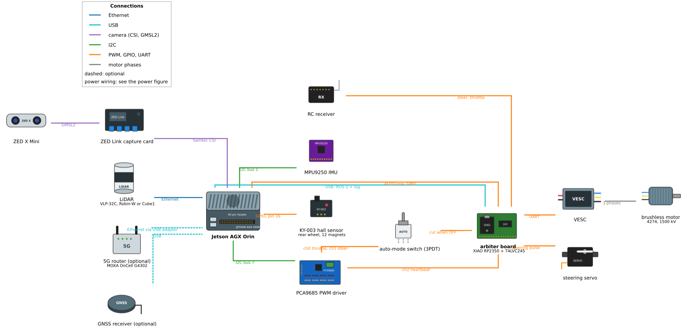
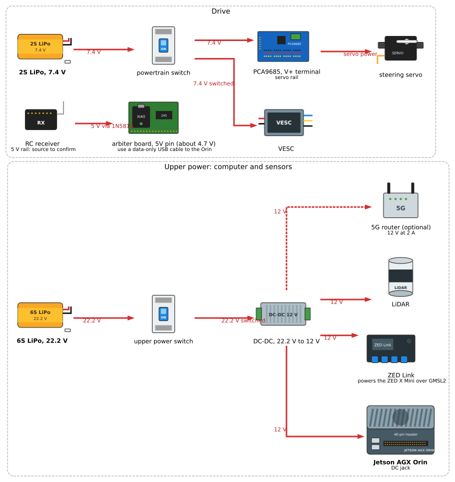

<!--
Translation Metadata:
- Source file: hardware.md
- Last synced: 2026-11-02
- Translator: Claude (Anthropic)
- Status: Complete
-->

# 硬體詳情

車輛控制系統的實體硬體元件與電氣規格。

## PCA9685 PWM Driver

**規格**：
- **型號**：PCA9685 16 通道 PWM 控制器
- **介面**：I2C
- **I2C 位址**：0x40（預設）
- **I2C 匯流排**：Bus 7（AGX Orin 上的 `/dev/i2c-7`，排針腳位 3 與 5）
- **PWM 頻率**：60 Hz（`actuator.yaml` 中的 `pwm_freq`）
- **解析度**：12 位元（4096 步進）

**通道分配**：
- **通道 0**：電機 ESC 控制
- **通道 1**：轉向伺服馬達控制
- **通道 2-15**：可供擴充使用

**I2C 配線**：
```
PCA9685         Jetson/Computer
────────        ───────────────
VCC      ────── 3.3V or 5V (check board)
GND      ────── GND
SDA      ────── I2C SDA (pin 3, I2C bus 7)
SCL      ────── I2C SCL (pin 5, I2C bus 7)
```

**電源**：
- 邏輯電源：3.3V 或 5V（來自電腦）
- 伺服馬達電源：外部 5V 供電（V+、GND）
  - **重要**：將外部 5V 連接至 V+ 端子以供伺服馬達使用
  - 請勿從電腦的 5V 軌供電給伺服馬達（電流不足）

**裝置偵測**：
```bash
# Check I2C devices on bus 7
sudo i2cdetect -y 7

# Expected output:
#      0  1  2  3  4  5  6  7  8  9  a  b  c  d  e  f
# 00:          -- -- -- -- -- -- -- -- -- -- -- -- --
# 40: 40 -- -- -- -- -- -- -- -- -- -- -- -- -- -- --
```

**權限**：

將使用者加入 i2c 群組：
```bash
sudo usermod -a -G i2c $USER
# Log out and back in for changes to take effect

# Verify membership
groups $USER | grep i2c
```

**Python 函式庫**：

Actuator 節點使用 Adafruit 的 PCA9685 函式庫：

```python
from Adafruit_PCA9685 import PCA9685

# Initialize PCA9685
pwm = PCA9685(address=0x40, busnum=7)  # i2c_busnum in actuator.yaml
pwm.set_pwm_freq(60)  # 60 Hz for RC servos/ESC

# Set motor PWM (channel 0)
pwm.set_pwm(0, 0, motor_pwm)

# Set steering PWM (channel 1)
pwm.set_pwm(1, 0, steering_pwm)
```

## 電機 ESC

**硬體**：Dynamite Fuze 無刷 ESC，驅動 4274 / 1500 kV 無刷馬達

**PWM 訊號需求**：
- 頻率：60 Hz（16.7 ms 週期）
- PWM 值是每個週期 4096 中的計數，因此脈衝寬度為
  `value × 16.67 ms / 4096`——每個計數約 4.07 μs。空檔 370 對應 1.51 ms 的脈衝。

**PWM 值**（取自 `actuator.yaml`，以該檔案為準——重要時請直接查閱）：

| 參數        | 值  | 意義                         |
|-------------|-----|------------------------------|
| `min_pwm`   | 360 | 控制器輸出的最低值（倒車）   |
| `brake_pwm` | 340 | 煞車，用於前進轉倒車的過渡   |
| `init_pwm`  | 370 | 空檔——車輛停止               |
| `max_pwm`   | 470 | 控制器輸出的最高值（前進）   |

PWM 與速度之間沒有固定的對照表。速度採閉迴路控制：actuator 節點中的 PID
控制器依據霍爾感測器量到的速度調整 PWM，因此達到某一速度所需的 PWM 會隨電池電量、
負載與地面而改變。校正方式請參閱[調校與測試](./tuning-and-testing.md)。

**配線**：
```
ESC             PCA9685          Motor           Power
────            ───────          ─────           ─────
Signal   ────── Channel 0
GND      ────── GND
                                 Phase A  ────── ESC A
                                 Phase B  ────── ESC B
                                 Phase C  ────── ESC C
Battery+ ──────────────────────────────────────── Battery+
Battery- ──────────────────────────────────────── Battery-/GND
```

**電源需求**：
- 工作電壓：本車為 7.4 V（2S LiPo）；更換電池前請先確認 ESC 的額定值
- 電流額定值：需與馬達規格匹配
- **安全**：務必最後連接 ESC 電池，最先移除

## 轉向伺服馬達

**硬體**：標準 RC 伺服馬達（例如 Futaba S3003）

**PWM 訊號需求**：
- 頻率：60 Hz（與電機通道共用）

**PWM 值**（取自 `actuator.yaml`）。**轉向在硬體上是反向的：數值越低越往右轉。**

| 參數         | 值  | 轉向位置     |
|--------------|-----|--------------|
| `min_steer`  | 439 | 最大右轉     |
| `init_steer` | 489 | 中心（直行） |
| `max_steer`  | 539 | 最大左轉     |

**最大轉向角度**：0.349 rad ≈ 20°（`vehicle_info.param.yaml` 中的
`max_steer_angle`）。actuator 會連同 `wheel_base` 與 `wheel_tread` 一起直接從該檔案讀取——
也就是規劃器所用的同一份檔案——因此不需要維護第二份副本。

車輪在最大轉角時實際達到的角度**尚未量測**。角度轉 PWM 的換算
`tire_angle_to_steer_ratio: -1000` 在僅 0.05 rad 時就達到 ±50 計數的上限，
這表示該比例或 20° 這個數字其中之一有誤；解決方法（繞圓測試）請參閱
[已知設定缺陷 §8](https://github.com/NEWSLabNTU/AutoSDV/blob/develop/docs/known-config-defects.md)。

**配線**：
```
Servo           PCA9685          External Power
─────           ───────          ──────────────
Signal (white)  Channel 1
Power (red)                      5V supply+
Ground (black)  GND              5V supply-/GND
```

**電源需求**：
- 工作電壓：4.8V - 6.0V（標準伺服馬達的典型值）
- 電流消耗：0.5A - 1.5A（取決於負載與速度）
- **重要**：使用獨立的 5V 電源供應給伺服馬達
  - 伺服馬達在運動時會消耗高電流
  - 電源不足會導致抖動或無法回應

**實體安裝**：
- 將伺服馬達固定在底盤上
- 將伺服馬達臂連接至轉向連桿
- 確保全範圍運動（439–539 PWM）不會卡住
- 在連接連桿前，先將伺服馬達置於 PWM 489 的中心位置

## 霍爾效應感測器（速度感測）

**硬體**：KY-003 霍爾效應磁性感測器模組

**用途**：偵測輪胎旋轉以測量速度

**規格**：
- **類型**：數位霍爾效應感測器
- **輸出**：偵測到磁鐵時產生數位脈衝（HIGH/LOW）
- **工作電壓**：3.3V - 5V
- **工作電流**：~5mA
- **偵測範圍**：距磁鐵 <5mm
- **LED 指示燈**：偵測到磁鐵時板上 LED 閃爍

**GPIO 連接**：
```
KY-003          Jetson/Computer
──────          ───────────────
VCC      ────── 5V or 3.3V
GND      ────── GND
Signal   ────── Pin 16 (`pin` in velocity_report.yaml)
```

**GPIO 配置範例**：
```yaml
# velocity_report.yaml
pin: 16                        # physical header pin (Jetson.GPIO BOARD numbering)
wheel_diameter: 10.5           # cm
markers_per_rotation: 12
```

**磁鐵設定**：
- **磁鐵**：小型釹磁鐵（例如 5mm 直徑）
- **數量**：本車使用 12 個磁鐵（`velocity_report.yaml` 中的 `markers_per_rotation`）
- **位置**：均勻分布在輪圈周圍
- **間隙**：感測器到磁鐵距離 < 5mm 以確保可靠偵測
- **極性**：北極或南極面向感測器（一致的方向）

**實體安裝**：

1. **安裝感測器**：
   - 將 KY-003 感測器固定在底盤上靠近輪胎處
   - 將感測器定位在距輪圈 <5mm 處
   - 確保感測器在旋轉時不會接觸輪胎

2. **貼附磁鐵**：
   - 清潔輪圈表面
   - 均勻分布磁鐵（360° / markers_per_rotation）
   - 使用黏著劑（例如強力膠）固定磁鐵
   - 驗證磁鐵對齊感測器路徑

3. **測試偵測**：
   - 用手慢慢旋轉輪胎
   - KY-003 上的 LED 應該在每個磁鐵經過時閃爍
   - 若 LED 不閃爍，調整感測器位置或間隙

**上拉電阻**：

某些感測器可能需要在訊號線上使用上拉電阻：
```bash
# Enable internal pull-up on GPIO pin (if needed)
# This is typically configured in GPIO library initialization
```

**配線注意事項**：
- 若線材長度 > 30cm，使用遮蔽電纜（減少雜訊）
- 將感測器電纜遠離電機/ESC 電線（EMI）
- 使用熱縮管或電工膠帶固定連接處

## IMU 感測器（用於轉向回饋）

**用途**：為轉向回饋控制提供偏航率測量

**介面**：ROS 主題 `/sensing/imu/imu_data`

**在控制中的角色**：
- **正常模式**轉向控制（v ≥ 0.3 m/s）需要 IMU
- 提供測量到的偏航率（繞 Z 軸的角速度）
- 啟用閉迴路回饋以補償干擾

**不需要 IMU 的情況**：
- **後備模式**轉向（v < 0.3 m/s）
- 低速時的開迴路前饋控制

**來源**：ZED X Mini 內建 IMU（`imu_source:=zed`）；車輛沒有另外的 IMU。

IMU 設定請參閱[感測器整合指南](../sensor-integration/imu.md)。

## 配線摘要

### 配線圖

訊號側與電源側的配線圖，出自[配線圖](../../reference/hardware/wiring-diagrams.md)參考頁；該頁還有 Jetson 40 針接頭的逐針圖：





### 連接表

| 元件               | 連接至            | 腳位/通道       | 備註                            |
|--------------------|-------------------|-----------------|--------------------------------|
| PCA9685 SDA        | Computer I2C SDA  | Pin 3 (Jetson)  | I2C 資料                        |
| PCA9685 SCL        | Computer I2C SCL  | Pin 5 (Jetson)  | I2C 時脈                        |
| PCA9685 VCC        | 3.3V or 5V        |                 | 邏輯電源                        |
| PCA9685 V+         | 5V external       | 2A+ capacity    | 伺服馬達電源供應                |
| PCA9685 GND        | Common GND        |                 | 接地參考                        |
| PCA9685 Ch 0       | ESC Signal        |                 | 電機控制 PWM                    |
| PCA9685 Ch 1       | Servo Signal      |                 | 轉向控制 PWM                    |
| Hall Effect VCC    | 5V or 3.3V        |                 | 感測器電源                      |
| Hall Effect GND    | Common GND        |                 |                                 |
| Hall Effect Signal | Pin 16            | BOARD numbering | 可配置                          |
| ESC Battery+       | Battery+          | 7.4 V (2S)      | 電機電源（檢查 ESC 額定值）     |
| ESC Battery-       | Common GND        |                 |                                 |
| Servo Power        | 5V external       | 1A+ capacity    | 與 PCA9685 V+ 分開              |
| Servo GND          | Common GND        |                 |                                 |

### 電源分配

**電源軌**：
1. **電池電源**（7.4 V，2S）：僅供電機 ESC 使用
2. **5V 外部電源**：伺服馬達與 PCA9685 V+
3. **3.3V/5V 邏輯電源**：PCA9685 VCC、霍爾效應感測器
4. **共地 GND**：所有元件共用共地

**電流需求**：
- 電機 ESC：10A-30A（取決於馬達與負載）
- 轉向伺服馬達：0.5A-1.5A（運動時峰值）
- PCA9685 邏輯：10mA
- 霍爾效應感測器：5mA

**安全注意事項**：
- 高電流連接（電機電池）使用適當線徑
- 在電池連接處加上保險絲（額定值比最大預期電流高 10%）
- 將大電流路徑與訊號線分開以減少 EMI
- 使用適當的連接器固定所有連接（避免裸線連接）
- 上電前再次檢查極性

## 測試硬體連接

### 測試 PCA9685

```bash
# Check I2C device detection
sudo i2cdetect -y 7
# Should show device at 0x40

# Test PWM output (careful - vehicle may move!)
# Use control_test calibration mode instead of direct commands
```

### 測試霍爾效應感測器

```bash
# Monitor velocity topic
ros2 topic echo /vehicle/status/velocity_status

# Rotate wheel by hand
# Velocity should show non-zero values as wheel rotates
# LED on KY-003 should blink as magnets pass
```

### 測試 IMU

```bash
# Check IMU topic
ros2 topic echo /sensing/imu/imu_data

# Should see angular_velocity.z changing when vehicle rotates
```

## 下一步

- **了解控制演算法**：[控制詳情](./control-details.md)
- **測試系統**：[調校與測試](./tuning-and-testing.md)
- **返回總覽**：[總覽](./overview.md)
