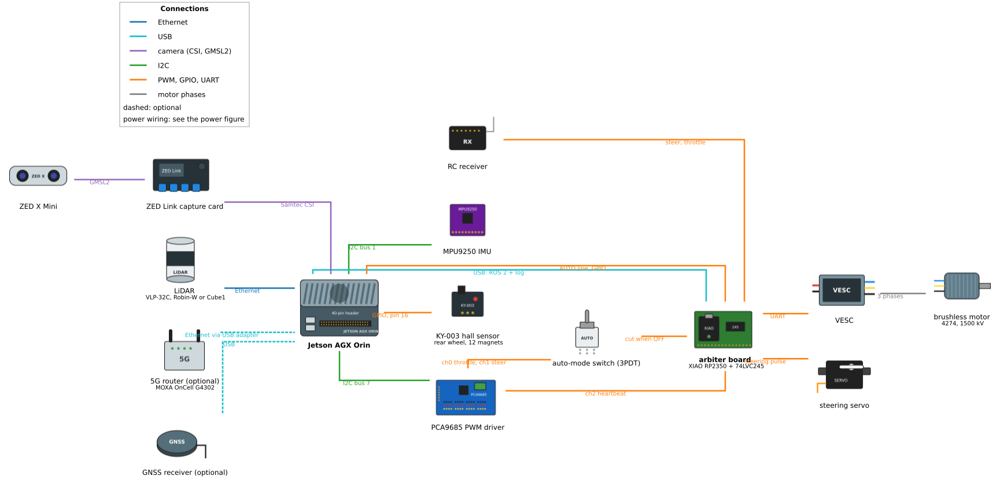
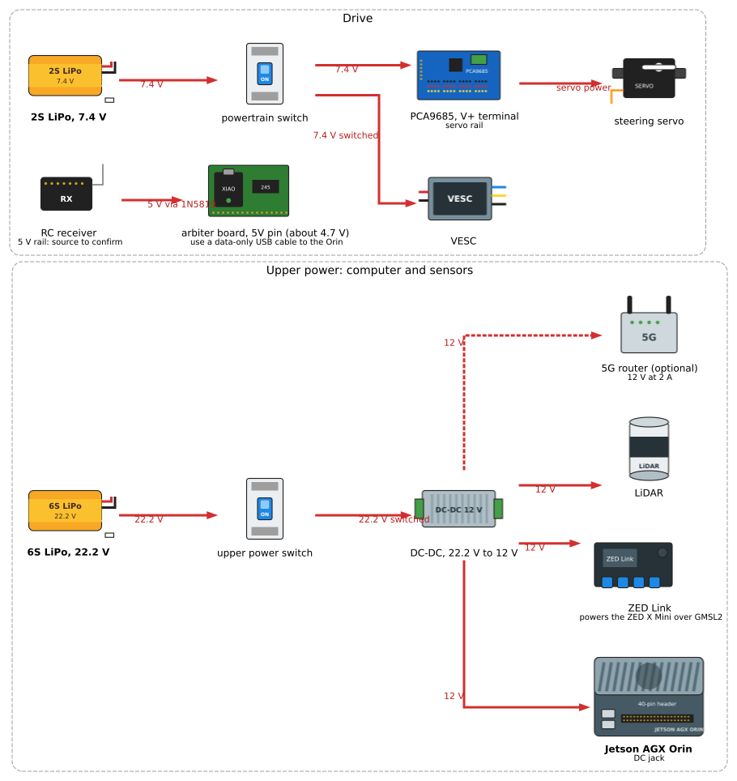
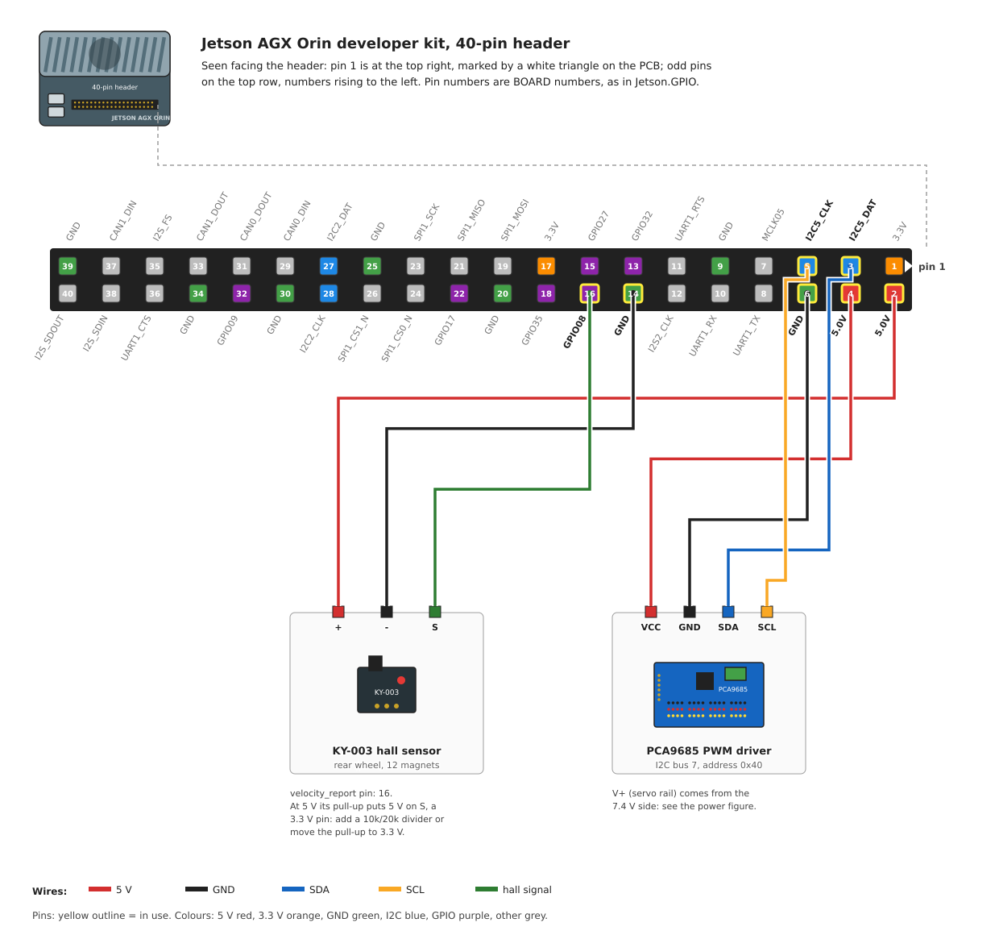

# Wiring Diagrams

Every electrical connection on the vehicle, in three figures: the signal and
data links, the power distribution, and the Jetson's 40-pin header pin by
pin. The figures are generated from source in the book repository
(`just diagrams`), so a wiring change is a change to one file there.

⚠️ **WARNING**: Always disconnect both batteries before wiring changes.

## Signals and data

| Link | From | To | Carries |
|---|---|---|---|
| GMSL2 | ZED X Mini | ZED Link capture card | stereo video and the camera's IMU; also powers the camera |
| Samtec CSI | ZED Link | Jetson AGX Orin (underside) | camera data |
| Ethernet | LiDAR | Jetson | point clouds (addresses below) |
| USB | 5G router (optional) | Jetson, via a USB-to-Ethernet adapter | uplink |
| USB | GNSS receiver (optional) | Jetson | position fixes |
| GPIO | KY-003 hall sensor | Jetson header pin 16 | one pulse per magnet, 12 per wheel turn |
| I2C bus 7 | Jetson header pins 3 and 5 | PCA9685, address 0x40 | PWM commands |
| PWM | PCA9685 ch0, ch1 | selector switch | the Orin's throttle and steer pulses |
| PWM | RC receiver | selector switch | the joystick's throttle and steer pulses |
| PWM | selector switch | motor ESC (throttle), steering servo (steer) | whichever source the switch selects |
| 3 phases | motor ESC | brushless motor | motor current |

The selector switch decides who drives: in one position the ESC and the servo
see the PCA9685's pulses, in the other the receiver's. The Orin is not told
which; it reads the car's state from the hall sensor and the camera either
way.

## Power

Two batteries, two switches, and no connection between the two sides other
than signal ground. The PCA9685 and the steering servo run on the Orin's 5 V,
so they belong to the computer side:

| Rail | Source | Loads |
|---|---|---|
| 22.2 V (6S LiPo) | upper power switch, then the DC-DC converter | — |
| 12 V | DC-DC converter output | Jetson AGX Orin (DC jack), ZED Link, LiDAR, 5G router |
| 11.1 V (3S LiPo) | powertrain switch | motor ESC only |
| 5 V | Jetson header pins 2 and 4 | KY-003; PCA9685 logic (VCC) and servo rail (V+) |
| servo rail | PCA9685 V+ terminal | steering servo power pin |
| 6 V | the ESC's built-in BEC, over its receiver lead | RC receiver |

Each battery has its own cell monitor with an alarm on the JST-XH balance
lead. The ZED X Mini draws its power over the GMSL2 cable from the ZED Link,
which is why it has no line of its own in the power figure.

## Jetson AGX Orin 40-pin header

Pin numbers are BOARD numbers, the ones `velocity_report.yaml` and
Jetson.GPIO use. Pin 1 is at the top right when you face the header, marked
by a white triangle on the carrier board; odd pins run along the top row.
Pin names are NVIDIA's, from the carrier board specification.

| Device | Label | Pin | Pin | Label | Device |
|---|---|---|---|---|---|
| | 3.3V | 1 | 2 | 5.0V | KY-003 |
| PCA9685 | I2C5_DAT (I2C bus 7) | 3 | 4 | 5.0V | PCA9685 |
| PCA9685 | I2C5_CLK (I2C bus 7) | 5 | 6 | GND | PCA9685 |
| | MCLK05 | 7 | 8 | UART1_TX | |
| | GND | 9 | 10 | UART1_RX | |
| | UART1_RTS | 11 | 12 | I2S2_CLK | |
| | GPIO32 | 13 | 14 | GND | KY-003 |
| | GPIO27 (PWM) | 15 | 16 | GPIO08 | KY-003 |
| | 3.3V | 17 | 18 | GPIO35 (PWM) | |
| | SPI1_MOSI | 19 | 20 | GND | |
| | SPI1_MISO | 21 | 22 | GPIO17 | |
| | SPI1_SCK | 23 | 24 | SPI1_CS0_N | |
| | GND | 25 | 26 | SPI1_CS1_N | |
| | I2C2_DAT (I2C bus 1) | 27 | 28 | I2C2_CLK (I2C bus 1) | |
| | CAN0_DIN | 29 | 30 | GND | |
| | CAN0_DOUT | 31 | 32 | GPIO09 | |
| | CAN1_DOUT | 33 | 34 | GND | |
| | I2S_FS | 35 | 36 | UART1_CTS | |
| | CAN1_DIN | 37 | 38 | I2S_SDIN | |
| | GND | 39 | 40 | I2S_SDOUT | |

The hall sensor moved from pin 15 to pin 16 on 2026-10-27, after pin 15 on
one car stopped delivering edges; every car now uses pin 16. Powered from
5 V, the KY-003's pull-up puts 5 V on its signal pin, which is a 3.3 V input:
add a 10 kΩ / 20 kΩ divider, or move the pull-up to 3.3 V.

The full pinout is on NVIDIA's
[hardware layout page](https://docs.nvidia.com/jetson/agx-orin-devkit/user-guide/latest/hardware_layout.html).

## Sensors

### LiDAR

One LiDAR at a time, on the Jetson's Ethernet port, powered from the 12 V
rail.

| Model | Address | Ports | Time sync |
|---|---|---|---|
| Velodyne VLP-32C | 192.168.1.201 | 2368 (data), 8308 (position) | optional PPS input |
| Seyond Robin-W | 192.168.1.10 | 2368 | IEEE 1588 PTP |
| Blickfeld Cube1 | 192.168.1.21 | 8000 | — |

### Camera and IMU (ZED X Mini)

The ZED X Mini connects to the ZED Link capture card over one GMSL2 Fakra
cable, which carries video, the camera's IMU data and power. The ZED Link
sits on the underside of the Jetson AGX Orin, on the Samtec CSI connector,
and takes 12 V on its own DC input. The camera's IMU is the vehicle's IMU
(`imu_source:=zed`).

### Hall sensor (KY-003)

| KY-003 | Jetson header |
|---|---|
| + | pin 2 (5 V) |
| − | pin 14 (GND) |
| S | pin 16 (GPIO08) |

Twelve magnets on the rear wheel; the
[hardware page](../../guides/vehicle-control/hardware.md) covers mounting.

### GNSS receiver (optional)

A u-blox receiver on USB, powered by the port. Its PPS output is not wired.

## Motor control

### PCA9685 PWM driver

| PCA9685 | Connects to |
|---|---|
| VCC | Jetson pin 4 (5 V) |
| GND | Jetson pin 6 |
| SDA | Jetson pin 3 (I2C5_DAT, bus 7) |
| SCL | Jetson pin 5 (I2C5_CLK, bus 7) |
| V+ | Jetson pin 2 (5 V), the servo rail |
| ch0 | motor ESC throttle, through the selector switch |
| ch1 | steering servo, through the selector switch |
| ch2–ch15 | free |

I2C address 0x40, PWM frequency 60 Hz (`pwm_freq` in `actuator.yaml`). The
channel order is `actuator.yaml`'s: channel 0 is the motor, channel 1 the
steering.

### ESC and motor

The motor ESC is a Dynamite Fuze brushless ESC. It takes the throttle pulse
from the selector switch and 11.1 V from its own 3S battery through the
powertrain switch, and drives the 4274 / 1500 kV brushless motor on three
phase leads. Its built-in 6 V BEC powers the RC receiver over the receiver
lead, so the receiver needs no supply of its own.

## 5G module (optional)

MOXA OnCell G4302 or similar: 12 V at 2 A from the DC-DC converter, two SIM
slots (primary and backup carrier), and an Ethernet port that reaches the
Jetson through a USB-to-Ethernet adapter.

## Battery management

| Battery | Use | Monitor |
|---|---|---|
| 6S, 22.2 V | computer and sensors | cell monitor with alarm on the 6-cell balance lead |
| 3S, 11.1 V | drive (ESC only) | cell monitor with alarm on the 3-cell balance lead |

Each monitor is independent; neither battery charges or feeds the other.

## Next Steps

- [Hardware Assembly Guide](../../getting-started/hardware-assembly.md) - Physical assembly
- [Software Installation](../../getting-started/installation/overview.md) - Software setup
- [Core Components](../hardware/core-components.md) - Component specifications
