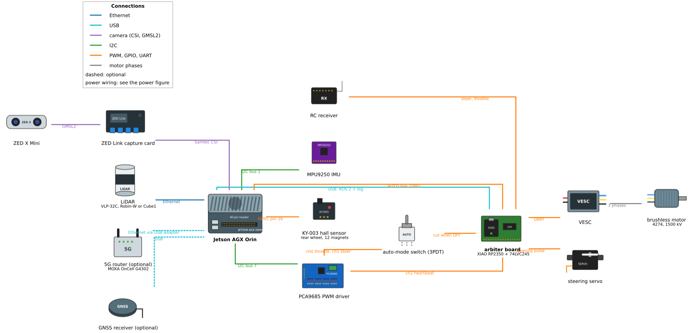
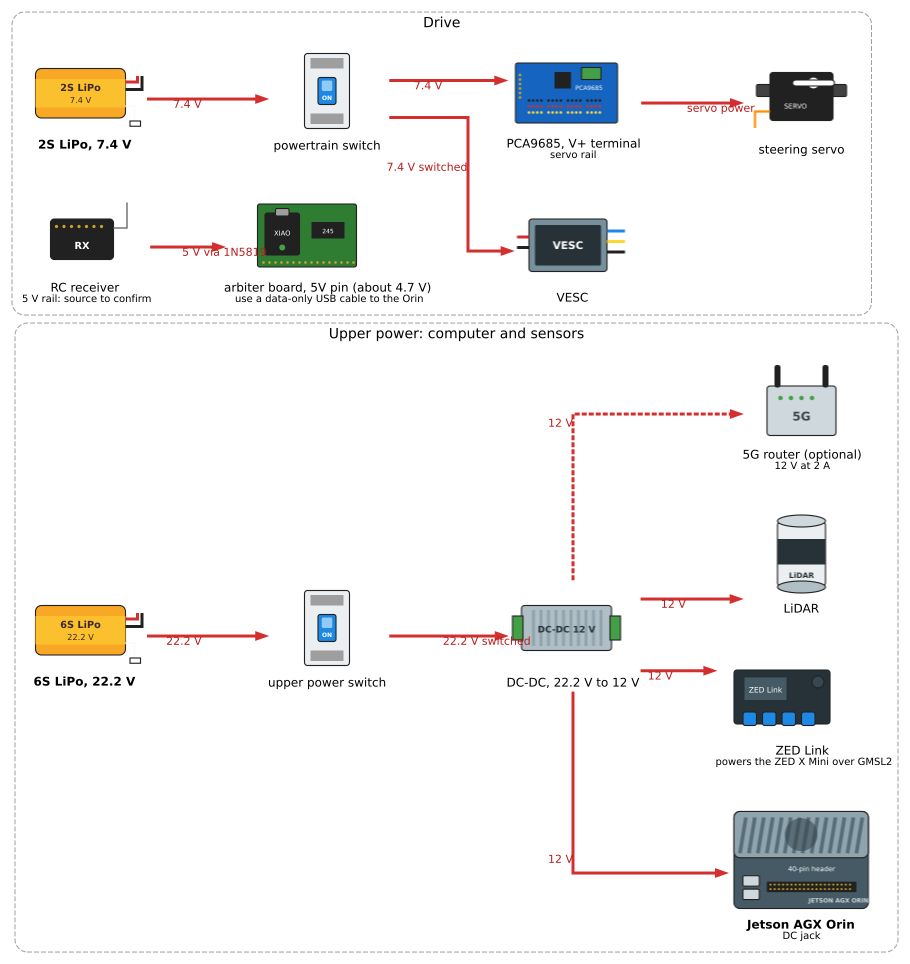
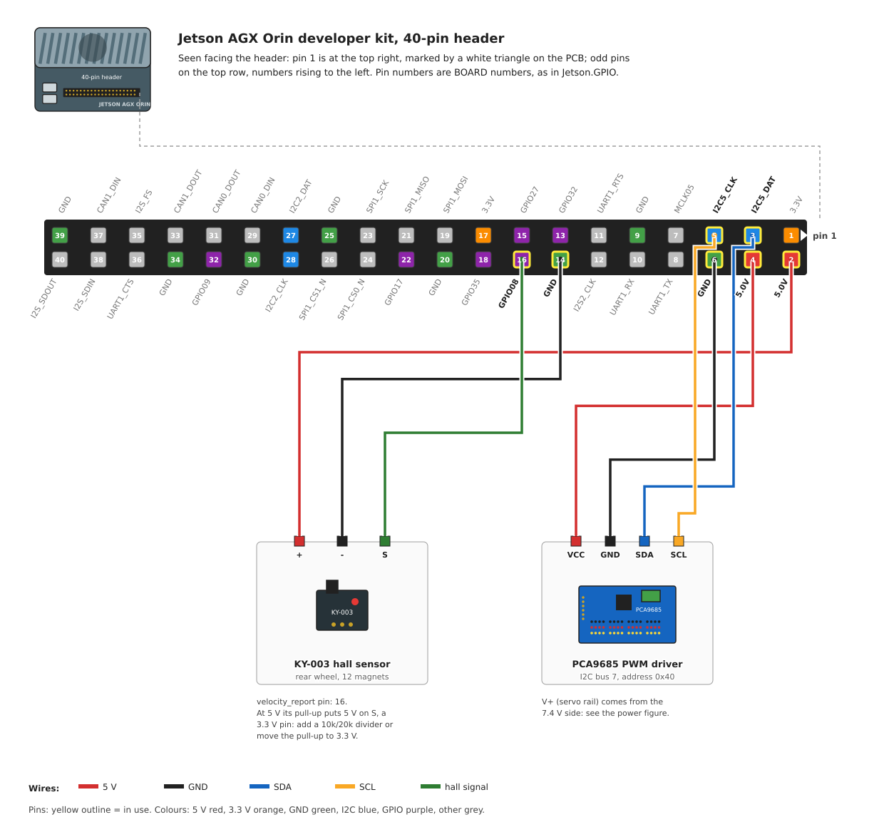

<!--
Translation Metadata:
- Source file: wiring-diagrams.md
- Last synced: 2026-11-02
- Translator: Claude (Anthropic)
- Status: Complete
-->

# 配線圖

車輛上的每一條電氣連接，分成三張圖：訊號與資料連線、電源分配，以及 Jetson 40 針接頭的逐針接法。這些圖由書籍儲存庫中的原始檔產生（`just diagrams`），所以配線變更就是改那裡的一個檔案。

⚠️ **警告**：配線變更前務必先拔除兩顆電池。

## 訊號與資料

| 連線 | 從 | 到 | 傳送內容 |
|---|---|---|---|
| GMSL2 | ZED X Mini | ZED Link 擷取卡 | 立體影像與相機的 IMU；同時供電給相機 |
| Samtec CSI | ZED Link | Jetson AGX Orin（底部） | 相機資料 |
| 乙太網路 | 光達 | Jetson | 點雲（位址見下） |
| USB | 5G 路由器（選配） | Jetson，經 USB 轉乙太網路轉接器 | 上行連線 |
| USB | GNSS 接收器（選配） | Jetson | 定位資料 |
| GPIO | KY-003 霍爾感測器 | Jetson 接頭第 16 針 | 每顆磁鐵一個脈衝，每轉 12 個 |
| I2C bus 7 | Jetson 接頭第 3、5 針 | PCA9685，位址 0x40 | PWM 指令 |
| PWM | PCA9685 ch0、ch1 | 選擇開關 | Orin 的油門與轉向脈衝 |
| PWM | RC 接收器 | 選擇開關 | 搖桿的油門與轉向脈衝 |
| PWM | 選擇開關 | 電機 ESC（油門）、轉向伺服（轉向） | 開關選中的那一個來源 |
| 三相 | 電機 ESC | 無刷馬達 | 馬達電流 |

選擇開關決定誰在駕駛：一個位置讓 ESC 與伺服收到 PCA9685 的脈衝，另一個位置則收到接收器的脈衝。Orin 不會被告知目前是哪一個；它一律從霍爾感測器與相機讀取車輛狀態。

## 電源

兩顆電池、兩個開關，兩側除了訊號地之外沒有任何連接。PCA9685 與轉向伺服使用 Orin 的 5 V，所以屬於電腦側：

| 電源軌 | 來源 | 負載 |
|---|---|---|
| 22.2 V（6S LiPo） | 上層電源開關，再到 DC-DC 轉換器 | — |
| 12 V | DC-DC 轉換器輸出 | Jetson AGX Orin（DC 插孔）、ZED Link、光達、5G 路由器 |
| 11.1 V（3S LiPo） | 動力開關 | 僅電機 ESC |
| 5 V | Jetson 接頭第 2、4 針 | KY-003；PCA9685 邏輯電源（VCC）與伺服電源軌（V+） |
| 伺服電源軌 | PCA9685 V+ 端子 | 轉向伺服的電源針 |
| 6 V | ESC 內建 BEC，經其接收器線 | RC 接收器 |

每顆電池都有自己的電芯監視器，警報接在 JST-XH 平衡線上。ZED X Mini 經由 GMSL2 線從 ZED Link 取電，所以電源圖中沒有它自己的線。

## Jetson AGX Orin 40 針接頭

針腳編號為 BOARD 編號，也就是 `velocity_report.yaml` 與 Jetson.GPIO 使用的編號。面對接頭時，第 1 針在右上角，載板上以白色三角形標示；奇數針沿上排排列。針腳名稱為 NVIDIA 載板規格書的名稱。

| 裝置 | 標籤 | 針 | 針 | 標籤 | 裝置 |
|---|---|---|---|---|---|
| | 3.3V | 1 | 2 | 5.0V | KY-003 |
| PCA9685 | I2C5_DAT（I2C bus 7） | 3 | 4 | 5.0V | PCA9685 |
| PCA9685 | I2C5_CLK（I2C bus 7） | 5 | 6 | GND | PCA9685 |
| | MCLK05 | 7 | 8 | UART1_TX | |
| | GND | 9 | 10 | UART1_RX | |
| | UART1_RTS | 11 | 12 | I2S2_CLK | |
| | GPIO32 | 13 | 14 | GND | KY-003 |
| | GPIO27（PWM） | 15 | 16 | GPIO08 | KY-003 |
| | 3.3V | 17 | 18 | GPIO35（PWM） | |
| | SPI1_MOSI | 19 | 20 | GND | |
| | SPI1_MISO | 21 | 22 | GPIO17 | |
| | SPI1_SCK | 23 | 24 | SPI1_CS0_N | |
| | GND | 25 | 26 | SPI1_CS1_N | |
| | I2C2_DAT（I2C bus 1） | 27 | 28 | I2C2_CLK（I2C bus 1） | |
| | CAN0_DIN | 29 | 30 | GND | |
| | CAN0_DOUT | 31 | 32 | GPIO09 | |
| | CAN1_DOUT | 33 | 34 | GND | |
| | I2S_FS | 35 | 36 | UART1_CTS | |
| | CAN1_DIN | 37 | 38 | I2S_SDIN | |
| | GND | 39 | 40 | I2S_SDOUT | |

霍爾感測器於 2026-10-27 從第 15 針移到第 16 針，因為某一台車的第 15 針不再送出邊緣訊號；現在每台車都用第 16 針。KY-003 以 5 V 供電時，其上拉電阻會把 5 V 加在訊號針上，而該針是 3.3 V 輸入：請加上 10 kΩ / 20 kΩ 分壓，或把上拉改接到 3.3 V。

完整腳位請見 NVIDIA 的[硬體配置頁面](https://docs.nvidia.com/jetson/agx-orin-devkit/user-guide/latest/hardware_layout.html)。

## 感測器

### 光達

一次一台光達，接在 Jetson 的乙太網路埠，由 12 V 電源軌供電。

| 型號 | 位址 | 埠 | 時間同步 |
|---|---|---|---|
| Velodyne VLP-32C | 192.168.1.201 | 2368（資料）、8308（位置） | 選配 PPS 輸入 |
| Seyond Robin-W | 192.168.1.10 | 2368 | IEEE 1588 PTP |
| Blickfeld Cube1 | 192.168.1.21 | 8000 | — |

### 相機與 IMU（ZED X Mini）

ZED X Mini 以一條 GMSL2 Fakra 線接到 ZED Link 擷取卡，這條線同時傳送影像、相機的 IMU 資料與電源。ZED Link 位於 Jetson AGX Orin 底部的 Samtec CSI 連接器上，並由自己的 DC 輸入取得 12 V。相機的 IMU 就是車輛的 IMU（`imu_source:=zed`）。

### 霍爾感測器（KY-003）

| KY-003 | Jetson 接頭 |
|---|---|
| + | 第 2 針（5 V） |
| − | 第 14 針（GND） |
| S | 第 16 針（GPIO08） |

後輪上有十二顆磁鐵；安裝方式見[硬體頁面](../../guides/vehicle-control/hardware.md)。

### GNSS 接收器（選配）

u-blox 接收器接在 USB，由該埠供電。其 PPS 輸出未接線。

## 電機控制

### PCA9685 PWM 驅動器

| PCA9685 | 連接到 |
|---|---|
| VCC | Jetson 第 4 針（5 V） |
| GND | Jetson 第 6 針 |
| SDA | Jetson 第 3 針（I2C5_DAT，bus 7） |
| SCL | Jetson 第 5 針（I2C5_CLK，bus 7） |
| V+ | Jetson 第 2 針（5 V），即伺服電源軌 |
| ch0 | 電機 ESC 油門，經選擇開關 |
| ch1 | 轉向伺服，經選擇開關 |
| ch2–ch15 | 未使用 |

I2C 位址 0x40，PWM 頻率 60 Hz（`actuator.yaml` 的 `pwm_freq`）。通道順序以 `actuator.yaml` 為準：通道 0 是馬達，通道 1 是轉向。

### ESC 與馬達

電機 ESC 是 Dynamite Fuze 無刷 ESC。它從選擇開關取得油門脈衝、經動力開關從自己的 3S 電池取得 11.1 V，並以三條相線驅動 4274 / 1500 kV 無刷馬達。其內建的 6 V BEC 經接收器線供電給 RC 接收器，接收器不需另外的電源。

## 5G 模組（選配）

MOXA OnCell G4302 或同類產品：由 DC-DC 轉換器供應 12 V、2 A，兩個 SIM 卡槽（主要與備用電信商），以及一個經 USB 轉乙太網路轉接器連到 Jetson 的乙太網路埠。

## 電池管理

| 電池 | 用途 | 監視器 |
|---|---|---|
| 6S，22.2 V | 電腦與感測器 | 電芯監視器，警報接在 6 芯平衡線 |
| 3S，11.1 V | 動力（僅 ESC） | 電芯監視器，警報接在 3 芯平衡線 |

兩個監視器各自獨立；兩顆電池互不充電、互不供電。

## 下一步

- [硬體組裝指南](../../getting-started/hardware-assembly.md) - 實體組裝
- [軟體安裝](../../getting-started/installation/overview.md) - 軟體設定
- [核心組件](../hardware/core-components.md) - 組件規格
